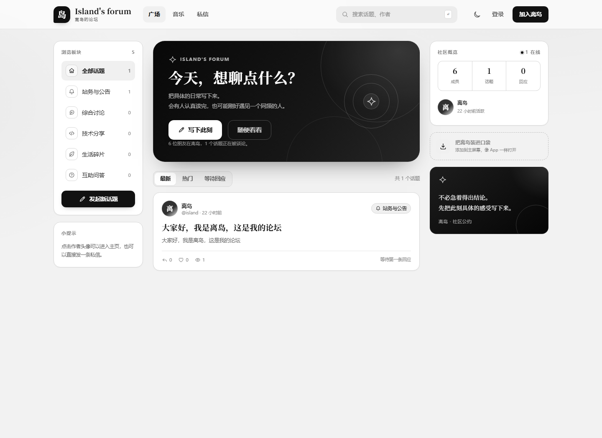
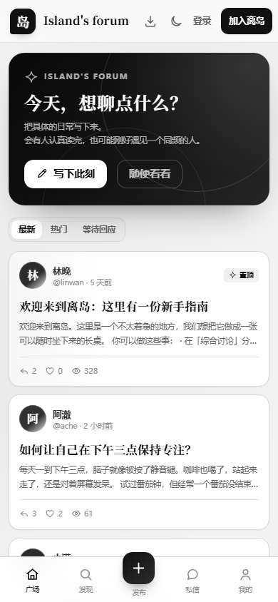
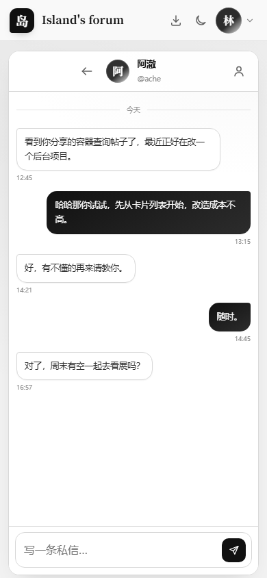
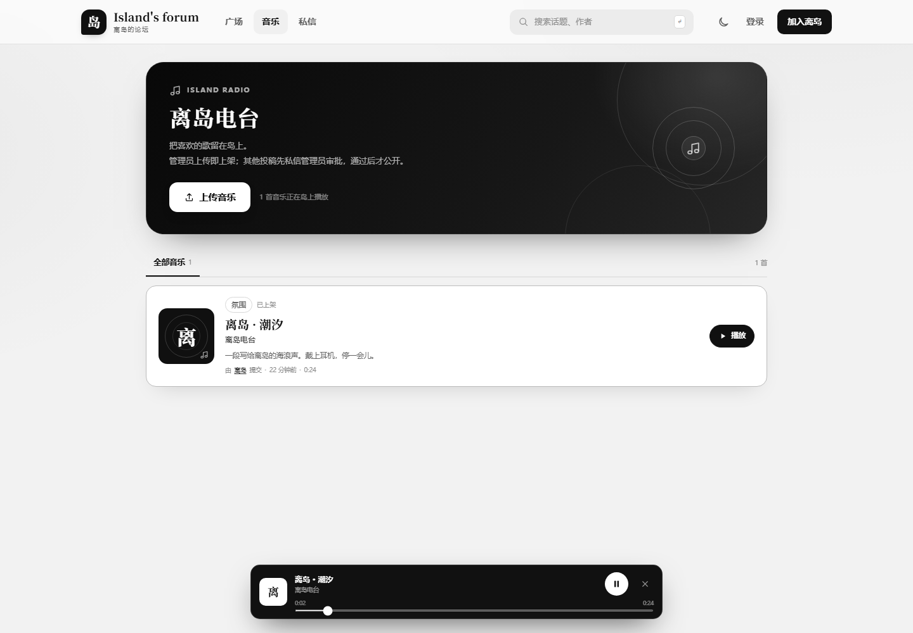

# Island's forum · 离岛的论坛

一个黑白极简的社区网站：支持注册登录、发帖、回复、点赞、搜索、个人主页、实时私聊和音乐电台。同一套代码会自动识别手机或电脑，并适配桌面网页与手机浏览器，也可安装到主屏幕（PWA）。

服务端功能基于 Node.js 24 内置模块实现，数据库使用内置的 `node:sqlite`。



<p align="center">
  
  &nbsp;&nbsp;
  
</p>

## 功能

- **账号体系**：注册、登录、退出、忘记密码；密码使用 `scrypt` 加盐哈希，会话使用 HttpOnly + SameSite Cookie。
- **密码重置**：用户输入账号提交申请，管理员核对身份并确认后，用户才能设置新密码；旧登录状态会全部失效。
- **话题广场**：五个板块、置顶、最新 / 热门 / 等待回应排序、分页加载。
- **发帖与回复**：标题与正文校验，草稿自动保存在本地，发布后直接进入话题页。
- **点赞与搜索**：话题、回复都可以点赞；支持按标题、正文、作者昵称搜索。
- **实时私信**：从作者头像或主页发起私信，SSE 实时推送新消息，未读数同步到导航栏和手机底栏。
- **个人主页**：昵称、简介、加入时间、话题 / 回复 / 收到的赞，以及最近发布的话题。
- **音乐电台**：管理员上传即上架；其他用户上传后必须审批，投稿私信通知管理员，审批结果再私信通知投稿人；所有访客都可以免费试听已上架音乐。
- **管理员**：`island` 账号可以删除任意话题和音乐、上架音乐、审批投稿、确认密码重置申请；删除前都有二次确认，删帖会清理回复和点赞，删音乐会同时移除音频文件。
- **自动识别设备**：结合 UA、触屏能力和视口宽度标记手机 / 平板 / 电脑，自动切换为对应的布局与交互。
- **手机体验**：响应式布局、底部标签栏、移动端全屏私信、安全区适配、输入框防 iOS 缩放。
- **黑白界面**：纯黑白灰视觉系统，支持同样黑白的深色模式。
- **PWA**：可安装到桌面或主屏幕，带离线应用外壳和快捷方式。

## 快速启动

要求 **Node.js 24+**（需要内置的 `node:sqlite`）。

```bash
cd forum-app
npm start
```

打开 <http://127.0.0.1:3000>。

访客账号：

| 用户名 | 密码 | 昵称 |
| --- | --- | --- |
| `linwan` | `demo1234` | 林晚 |
| `ache` | `demo1234` | 阿澈 |
| `xiaoman` | `demo1234` | 小满 |
| `chenmo` | `demo1234` | 陈默 |
| `shanzhi` | `demo1234` | 山栀 |

也可以在页面上直接注册新账号。

管理员账号：

| 用户名 | 密码 | 昵称 | 权限 |
| --- | --- | --- | --- |
| `island` | `qwE12qwE1` | 离岛 | 删除话题 / 音乐、上架音乐、审批投稿、确认密码重置 |

> 服务启动时会自动确保该管理员账号存在；登录后进入任意话题页，即可在操作栏看到「删除帖子」。

### 音乐与审批

1. 管理员进入「音乐」页上传音频，音乐立即公开。
2. 其他用户上传音频后，系统会自动向管理员发送一条私信审批申请。
3. 管理员在「音乐 → 待审批」试听后选择通过或拒绝。
4. 审批结果会自动私信通知投稿人；通过的歌曲进入公共音乐列表，所有人无需登录即可播放。
5. 管理员可以在任意音乐卡片上删除已上架、待审批或已拒绝的音乐；删除时音频文件会一并移除。

支持 MP3 / M4A / AAC / WAV / OGG / OPUS / WebM / FLAC，单首最大 25MB。音频支持 HTTP Range，可拖动进度条播放。



### 忘记密码

1. 在登录弹窗点击「忘记密码？」，输入用户名提交申请。
2. 管理员会收到一条私信，在「密码重置」页面核对身份。
3. 管理员确认后，用户页面自动出现设置新密码表单（申请 24 小时内有效）。
4. 设置成功后，该账号的所有旧登录状态立即失效。

管理员账号不允许走线上重置流程，需要在服务器上处理。


### 用手机访问

服务默认监听 `0.0.0.0`，启动时会打印局域网地址，例如：

```text
局域网(手机)访问: http://192.168.x.x:3000
```

让手机和电脑连接同一个 Wi-Fi，在手机浏览器打开这个地址即可。若要使用「添加到主屏幕」和离线能力，需要 HTTPS（`localhost` 除外）；普通局域网 HTTP 仍可正常浏览和使用全部论坛功能。

## 配置

通过环境变量覆盖默认值：

| 变量 | 默认值 | 说明 |
| --- | --- | --- |
| `PORT` | `3000` | HTTP 端口 |
| `HOST` | `0.0.0.0` | 监听地址 |
| `DB_PATH` | `data/forum.db` | SQLite 数据库路径 |
| `SEED` | `true` | 首次启动时是否写入演示数据 |

示例：

```bash
PORT=8080 DB_PATH=./data/forum.db npm start
```

### 重置演示数据

停止服务后删除数据库文件，再启动即可重新生成：

```bash
rm -f data/forum.db data/forum.db-shm data/forum.db-wal
npm start
```

## 测试

```bash
npm test
```

测试会在临时目录创建独立的 SQLite 数据库和音乐目录，覆盖注册、登录、发帖、回复、点赞、搜索、私信、未读数、SSE 实时推送、管理员权限与删帖、音乐上传与审批、管理员删除音乐、密码重置与管理员确认、音频 Range 播放、退出登录，不会影响正式数据。

## 目录结构

```text
forum-app/
├─ server.js              # 启动入口、端口与优雅退出
├─ src/
│  ├─ app.js              # HTTP 服务、REST API、SSE、静态资源
│  ├─ db.js               # SQLite 表结构、迁移与演示数据
│  └─ security.js         # scrypt 密码哈希、会话 token、头像配色
├─ public/
│  ├─ index.html          # 单页应用外壳与 SVG 图标集
│  ├─ styles.css          # 桌面 / 手机响应式视觉系统
│  ├─ app.js              # 路由、页面渲染与交互
│  ├─ theme-init.js       # 首屏避免主题闪烁
│  ├─ manifest.webmanifest
│  ├─ sw.js               # 离线缓存 Service Worker
│  └─ icons/              # PWA 图标
├─ tests/api.test.js
├─ data/forum.db          # 运行时生成，不提交
└─ data/music/            # 上传的音频文件，不提交
```

## API 一览

| 方法 | 路径 | 说明 |
| --- | --- | --- |
| `POST` | `/api/auth/register` | 注册并自动登录 |
| `POST` | `/api/auth/login` | 登录 |
| `POST` | `/api/auth/logout` | 退出登录 |
| `GET` | `/api/auth/me` | 当前用户与未读数 |
| `POST` | `/api/auth/password-reset/request` | 提交密码重置申请 |
| `GET` | `/api/auth/password-reset/status` | 查询重置申请状态 |
| `POST` | `/api/auth/password-reset/complete` | 管理员确认后设置新密码 |
| `GET` | `/api/admin/password-resets` | 管理员查看待确认申请 |
| `POST` | `/api/admin/password-resets/:id/review` | 管理员通过 / 拒绝申请 |
| `GET` | `/api/categories` | 板块列表 |
| `GET` | `/api/topics` | 话题列表（`q`、`category`、`sort`、`page`） |
| `POST` | `/api/topics` | 发布话题 |
| `GET` | `/api/topics/:id` | 话题详情与回复 |
| `POST` | `/api/topics/:id/replies` | 回复话题 |
| `POST` | `/api/topics/:id/like` | 点赞 / 取消点赞话题 |
| `POST` | `/api/topics/:id/delete` | 管理员删除话题及其回复 |
| `POST` | `/api/replies/:id/like` | 点赞 / 取消点赞回复 |
| `GET` | `/api/music` | 公开音乐列表；`scope=mine/pending` 查看投稿 / 审批 |
| `POST` | `/api/music/upload` | 上传音频（原始二进制 + query 元数据） |
| `GET` | `/api/music/:id/audio` | 播放音频，支持 Range |
| `POST` | `/api/music/:id/review` | 管理员通过 / 拒绝音乐 |
| `POST` | `/api/music/:id/delete` | 管理员删除音乐及音频文件 |
| `GET` | `/api/users/:id` | 公开个人主页 |
| `GET` | `/api/users?q=` | 搜索用户（需登录） |
| `GET` | `/api/conversations` | 私信会话列表 |
| `POST` | `/api/conversations` | 创建或获取与某人的会话 |
| `GET` | `/api/conversations/:id/messages` | 会话消息 |
| `POST` | `/api/conversations/:id/messages` | 发送私信 |
| `POST` | `/api/conversations/:id/read` | 标记会话已读 |
| `GET` | `/api/events` | SSE 实时消息事件 |
| `GET` | `/api/stats` | 社区统计与最近活跃用户 |

## 安全与部署说明

- 密码不存明文；会话 token 只存 SHA-256 摘要，原始 token 放在 HttpOnly Cookie 中。
- 所有写操作都会校验同源 `Origin`；除音乐上传使用原始音频流外，其余写操作要求 `Content-Type: application/json`，并配合 SameSite Cookie 降低 CSRF 风险。
- 登录、注册、发帖、回复、私信、音乐上传均有简单的内存速率限制；音频文件大小限制为 25MB。
- 用户输入由前端统一转义后渲染，服务端使用参数化 SQL，避免 XSS 与 SQL 注入。
- 部署到公网时建议放在 Caddy / Nginx 之后并启用 HTTPS；为实时私信保留 SSE 的长连接（关闭代理缓冲）。
- 当前版本面向单机小型社区：SQLite 使用 WAL，适合“读多写少”。如果要承载大规模并发或做多实例部署，需要替换为独立数据库、Redis 会话/限流与消息队列。

## 说明

「离岛」是虚构的演示社区，种子内容与人物均为示例数据。你可以直接替换 `src/db.js` 中的板块、访客用户与话题，开始自己的社区。
